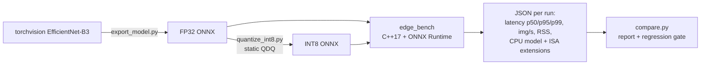

# edge-infer-bench

[](https://github.com/ChaiebDhia/edge-infer-bench/actions/workflows/ci.yml)

A small, reproducible harness that answers one question honestly: **what does post-training INT8 quantization
actually buy a vision model on a given CPU, and what does it cost in accuracy?** The benchmark is a C++17 program on
the ONNX Runtime C++ API. CI runs it on real **arm64** and **x86-64** GitHub runners and compares the two.

It grew out of [DeepCoin-Core](https://github.com/ChaiebDhia/DeepCoin-Core), where I fine-tuned an EfficientNet-B3
under a 4.3 GB VRAM limit and wanted to know what the same model costs to *run* on constrained CPUs.



## What the CI pipeline does

| Job | What it verifies |
|---|---|
| `lint` | `ruff` + `clang-format` |
| `build-test` | Builds with `-Wall -Wextra -Wpedantic -Wshadow -Werror` on **x64 and arm64**, each with and without **ASan + UBSan**; runs GoogleTest unit tests, an end-to-end test of the binary, and the Python tests |
| `models` | Exports EfficientNet-B3 and quantizes it to INT8 once, so both architectures benchmark byte-identical files |
| `bench` | Runs FP32 and INT8 at 1, 2 and 4 threads on x64 and arm64 |
| `report` | Publishes a Markdown table in the job summary and fails if the INT8 speedup regresses against the committed baseline |

Results are not hard-coded in this README. They live in [`docs/RESULTS.md`](docs/RESULTS.md), generated by CI and
stamped with the run and commit that produced them, because a number only means something next to the machine that
produced it. See [`docs/METHODOLOGY.md`](docs/METHODOLOGY.md) for exactly what is
timed, what is controlled, and what is *not* claimed.

## Run it locally

```bash
scripts/fetch_ort.sh                       # pinned ONNX Runtime, SHA-256 verified
cmake -S . -B build && cmake --build build -j
ctest --test-dir build --output-on-failure

build/edge_bench --model models/fp32.onnx --label fp32 --threads 4 --iters 100 --warmup 20
```

Benchmark your own model and measure the accuracy cost on real images:

```bash
python python/export_model.py --checkpoint my_model.pth --num-classes 438 --size 299 --out fp32.onnx
python python/quantize_int8.py --model fp32.onnx --out int8.onnx --size 299 --calib-dir data/train_subset
python python/eval_accuracy.py --fp32 fp32.onnx --int8 int8.onnx --data data/heldout --size 299
```

## Limitations (read these)

- CI models use random weights, so **CI measures speed, not accuracy**. Accuracy is a separate, local step on real data.
- Cloud VMs are noisy. Every row reports its coefficient of variation; the regression gate compares an in-job
  INT8/FP32 *ratio*, never absolute milliseconds.
- The harness records which ISA extensions the CPU exposes, **not** which kernels ONNX Runtime used. Confirming that
  needs profiling and is not done here.
- One model family, one runtime, batch size 1.

## Roadmap

- Profile with `perf` to confirm which kernels actually run on arm64.
- Add FP16 and compare execution providers/kernel libraries (XNNPACK, Arm Compute Library) behind the same harness.
- Multi-arch Docker image.

## Layout

```
src/        C++17 harness (bench.cpp) + header-only stats, CPU-feature parsing, JSON
tests/      GoogleTest unit tests; pytest tests for the Python tooling
python/     export, INT8 quantization, accuracy evaluation, suite runner, report + gate
scripts/    pinned, checksum-verified ONNX Runtime download
baselines/  committed per-architecture INT8-speedup baselines for the gate
docs/       methodology
```

MIT licensed.
